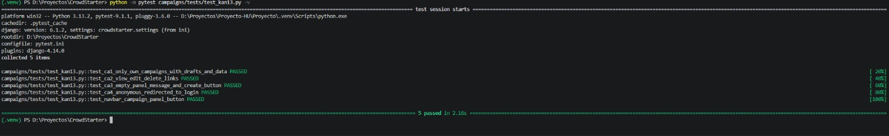
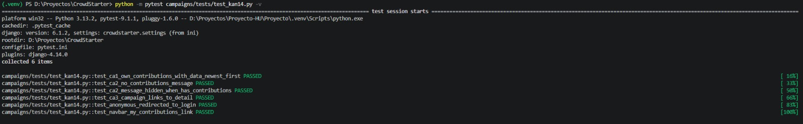

# Pruebas — KAN-13 y KAN-14

Resultados locales documentados mediante las capturas adjuntas. No representan una ejecución de Jenkins ni una prueba conjunta de todas las historias. Las capturas no identifican el commit probado.

## KAN-13 — Panel del creador

**Historia:** Como creador quiero ver y administrar mis campañas para tener control de mis proyectos en un solo lugar.

**Archivo:** `campaigns/tests/test_kan13.py` (5 pruebas)

| Prueba | Criterio | Qué verifica |
|---|---|---|
| `test_ca1_only_own_campaigns_with_drafts_and_data` | CA1 | El creador ve solo sus campañas, incluidos los borradores, con título, estado, recaudado y meta. Una campaña de otro usuario no aparece. |
| `test_ca2_view_edit_delete_links` | CA2 | Cada campaña tiene accesos a Ver, Editar y Eliminar, que apuntan a las URLs de esa campaña. |
| `test_ca3_empty_panel_message_and_create_button` | CA3 | Sin campañas, se muestran "Aún no has creado campañas" y el botón "Crear campaña" del panel. Se distingue del enlace "Crear campaña" de la barra de navegación. |
| `test_ca4_anonymous_redirected_to_login` | CA4 | Un usuario sin sesión es redirigido (HTTP 302) al login. |
| `test_navbar_campaign_panel_button` | Complementaria | El enlace "Panel de campañas" aparece en la barra de navegación solo para usuarios autenticados. |

**Datos de prueba:** una campaña activa y una en borrador del creador, una campaña de otro usuario y un aporte de $350 sobre una meta de $1000.

**Cambios en pruebas**

| Archivo | Cambio |
|---|---|
| `campaigns/tests/test_kan13.py` | Nuevo. Contiene las 5 pruebas de la tabla anterior. |

**Resultado:** 5 pruebas aprobadas.

---

## KAN-14 — Historial de aportes

**Historia:** Como financiador quiero ver mis aportes para saber a qué proyectos he apoyado.

**Archivo:** `campaigns/tests/test_kan14.py` (6 pruebas)

| Prueba | Criterio | Qué verifica |
|---|---|---|
| `test_ca1_own_contributions_with_data_newest_first` | CA1 | El financiador ve sus aportes con campaña, monto y fecha, del más reciente al más antiguo. Los aportes de otros usuarios no aparecen. |
| `test_ca2_no_contributions_message` | CA2 | Sin aportes, se muestra "Aún no has realizado aportes". |
| `test_ca2_message_hidden_when_has_contributions` | CA2 | Con aportes, el mensaje de lista vacía no aparece. |
| `test_ca3_campaign_links_to_detail` | CA3 | El nombre de la campaña enlaza a su detalle, y esa página responde con HTTP 200. |
| `test_anonymous_redirected_to_login` | Complementaria | Un usuario sin sesión es redirigido al login. |
| `test_navbar_my_contributions_link` | Complementaria | El enlace "Mis aportes" aparece en la barra de navegación solo para usuarios autenticados. |

**Datos de prueba:** dos aportes del financiador con fechas distintas (hace 5 días y hace 1 día) y un aporte de otro usuario. Como `created_at` se asigna automáticamente al crear el aporte, la prueba ajusta la fecha después de crearlo. Sin ese ajuste, los dos aportes quedarían con casi la misma hora y no se podría comprobar el orden.

**Cambios en pruebas**

| Archivo | Cambio |
|---|---|
| `campaigns/tests/test_kan14.py` | Nuevo. Contiene las 6 pruebas de la tabla anterior, más la función auxiliar `contribute()` para crear aportes con una fecha controlada. |

**Resultado:** 6 pruebas aprobadas.

[Volver al índice](README.md)
