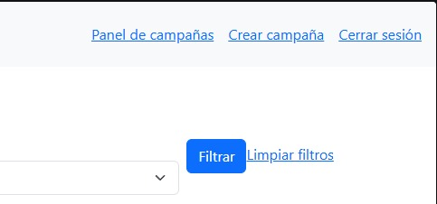
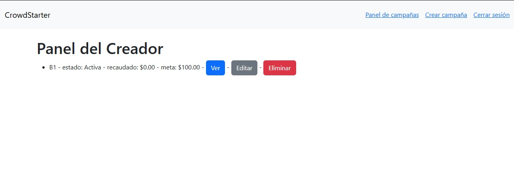
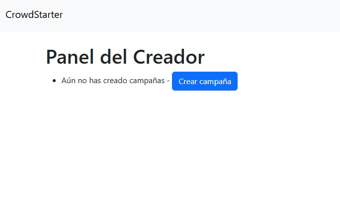
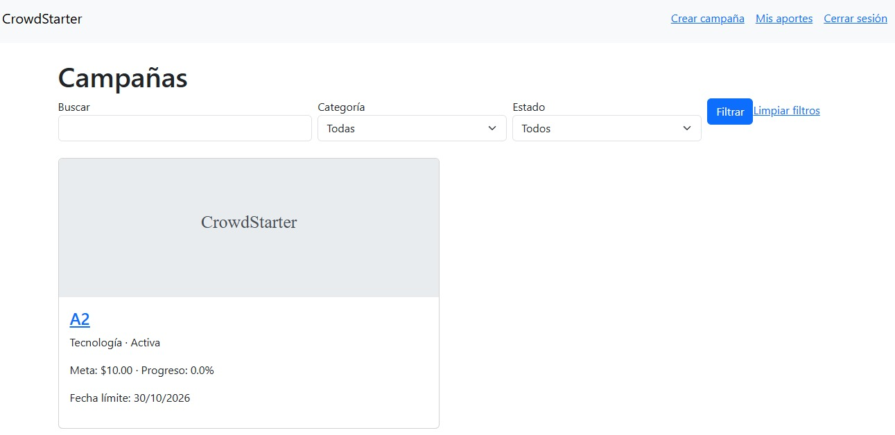
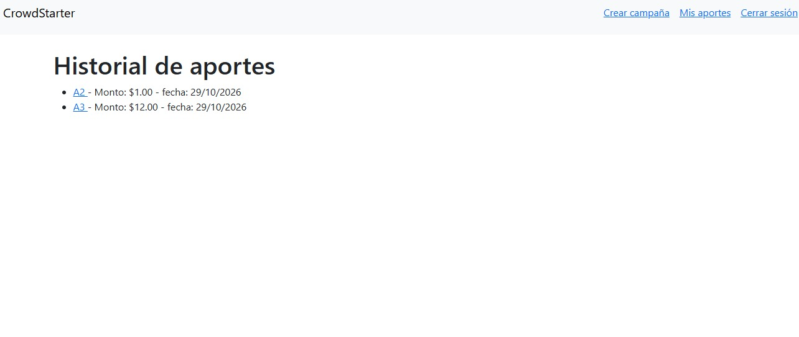
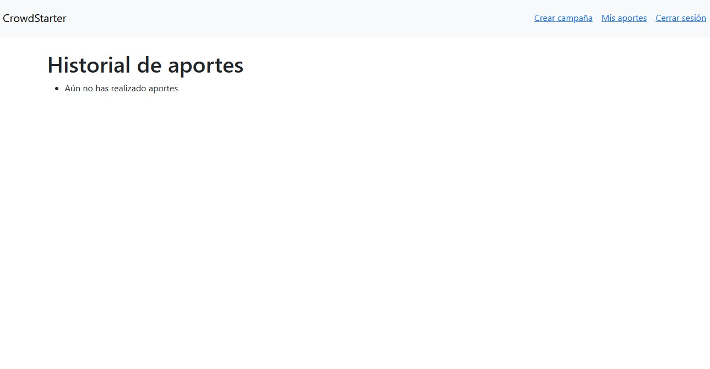

# Resumen y cambios — KAN-13 y KAN-14

## KAN-13 — Panel del creador

**Historia:** Como creador quiero ver y administrar mis campañas para tener control de mis proyectos en un solo lugar.

**Rama:** `feature/KAN-13-panel-del-creador`

### Resumen

Se agregó la página "Panel del Creador", donde un usuario autenticado ve todas las campañas que creó, incluidos los borradores, ordenadas de la más reciente a la más antigua. Cada campaña muestra su título, estado, monto recaudado y meta, junto con accesos directos para verla, editarla o eliminarla. Si el usuario no tiene campañas, se muestra un mensaje con un botón para crear una. La página requiere sesión iniciada, y en la barra de navegación se agregó el enlace "Panel de campañas".

### Criterios de aceptación

| Criterio | Implementación |
|---|---|
| CA1 — Ver solo sus campañas, incluidos borradores, con título, estado, recaudado y meta | La consulta filtra por `creator=request.user`, sin filtrar por estado. |
| CA2 — Accesos a Ver, Editar y Eliminar | Botones que enlazan a `campaign_detail`, `campaign_edit` y `campaign_delete`. |
| CA3 — Mensaje y botón "Crear campaña" sin campañas | Bloque `` con el mensaje y el enlace a `campaign_create`. |
| CA4 — Redirección al login sin sesión | Decorador `@login_required`, que usa `LOGIN_URL = "login"`. |

### Cambios

| Archivo | Tipo | Cambio |
|---|---|---|
| `campaigns/views.py` | Modificado | Nueva vista `creator_panel`, protegida con `@login_required`, que obtiene las campañas del usuario ordenadas por `-created_at`. |
| `campaigns/urls.py` | Modificado | Nueva ruta `campanas/panel_del_creador/` con nombre `creator_panel`. |
| `templates/campaigns/creator_panel.html` | Nuevo | Plantilla del panel, con la lista de campañas, los botones de acción y el mensaje para la lista vacía. |
| `templates/base.html` | Modificado | Enlace "Panel de campañas" en la barra de navegación, visible solo con sesión iniciada. |
| `campaigns/tests/test_kan13.py` | Nuevo | 5 pruebas automatizadas. |

No se agregaron migraciones.

### Evidencias

**Enlace "Panel de campañas" en la barra de navegación**

**Panel con campañas: datos de la campaña y botones Ver, Editar y Eliminar (CA1 y CA2)**

**Panel sin campañas: mensaje y botón "Crear campaña" (CA3)**

---

## KAN-14 — Historial de aportes

**Historia:** Como financiador quiero ver mis aportes para saber a qué proyectos he apoyado.

**Rama:** `feature/KAN-14-historial-de-aportes`

### Resumen

Se agregó la página "Historial de aportes" (Mis aportes), donde un usuario autenticado ve los aportes que realizó, ordenados del más reciente al más antiguo. Cada aporte muestra el nombre de la campaña, el monto y la fecha, y el nombre enlaza al detalle de la campaña. Si el usuario no ha realizado aportes, se muestra un mensaje. La página requiere sesión iniciada, y en la barra de navegación se agregó el enlace "Mis aportes".

### Criterios de aceptación

| Criterio | Implementación |
|---|---|
| CA1 — Ver sus aportes con campaña, monto y fecha, del más reciente al más antiguo | La consulta filtra por `user=request.user` y ordena por `-created_at`. La fecha se muestra con formato `d/m/Y`. |
| CA2 — Mensaje "Aún no has realizado aportes" | Bloque `` en la plantilla. |
| CA3 — Acceso al detalle de la campaña | El nombre de la campaña enlaza a `campaign_detail`. |

### Cambios

| Archivo | Tipo | Cambio |
|---|---|---|
| `campaigns/views.py` | Modificado | Nueva vista `user_contribution_history`, protegida con `@login_required`. Usa `select_related("campaign")` para traer los aportes y sus campañas en una sola consulta. |
| `campaigns/urls.py` | Modificado | Nueva ruta `mis-aportes/` con nombre `user_history_contributions`. |
| `templates/user/contribution_history.html` | Nuevo | Plantilla con la lista de aportes y el mensaje para la lista vacía. |
| `templates/base.html` | Modificado | Enlace "Mis aportes" en la barra de navegación, visible solo con sesión iniciada. |
| `campaigns/tests/test_kan14.py` | Nuevo | 6 pruebas automatizadas. |

No se agregaron migraciones.

### Evidencias

**Enlace "Mis aportes" en la barra de navegación**

**Historial con aportes: campaña, monto y fecha (CA1 y CA3)**

**Historial sin aportes (CA2)**

[Volver al índice](README.md)
